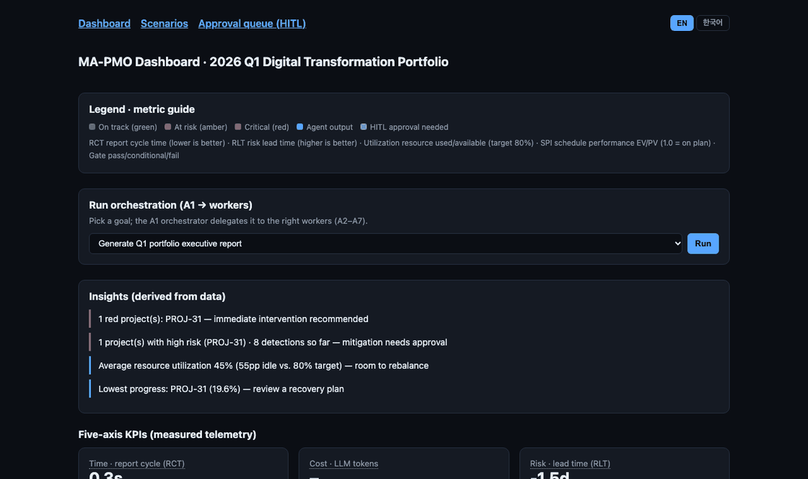
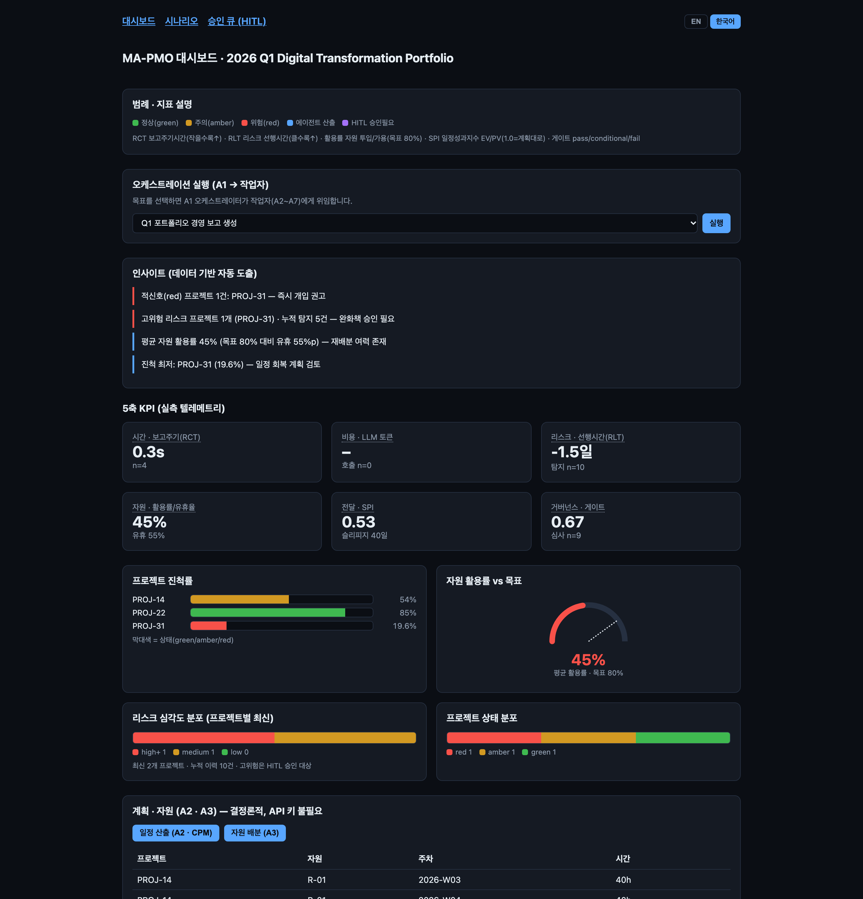
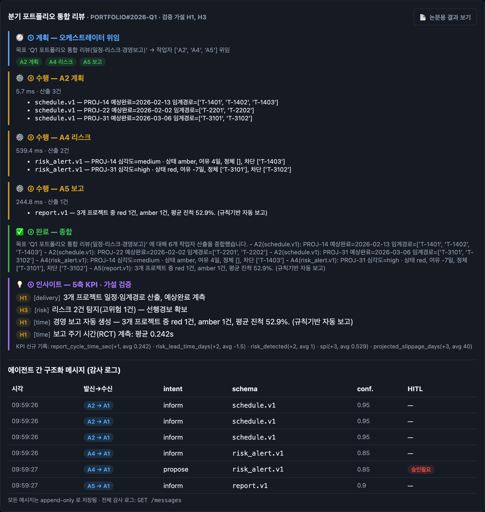
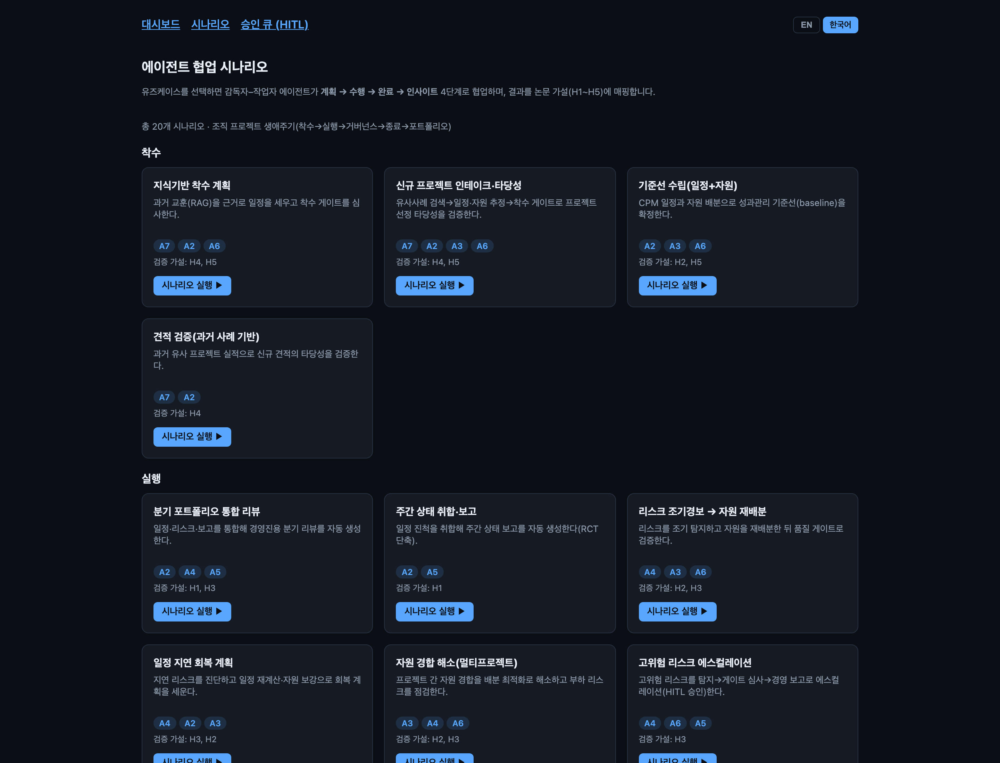
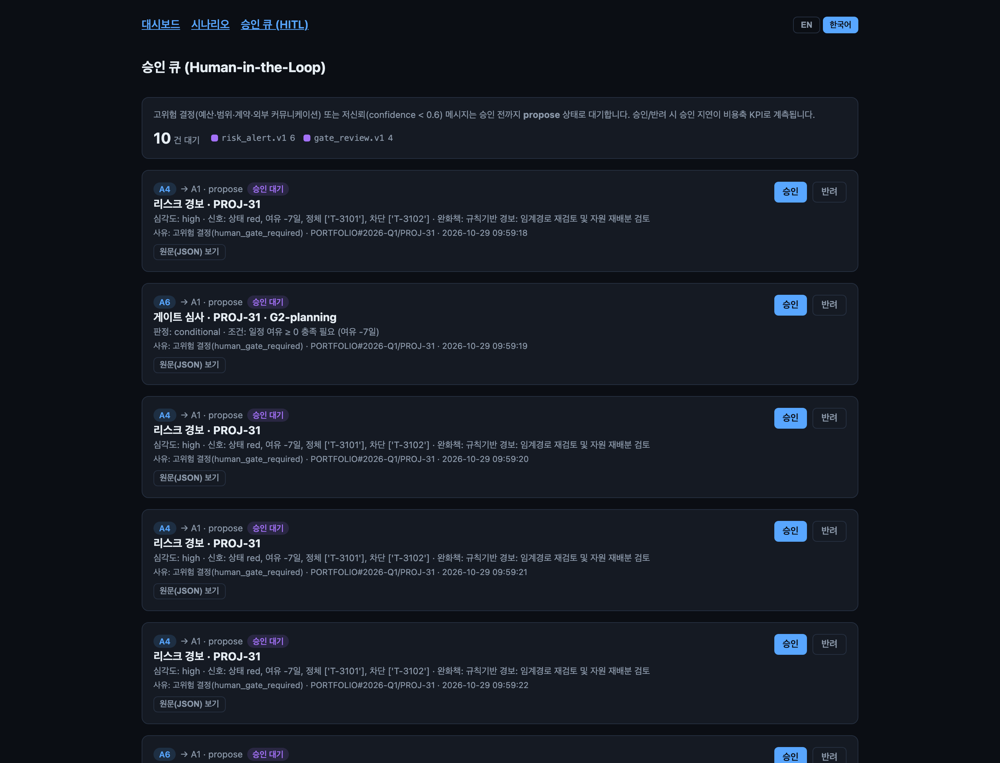

<p align="center">
  
</p>

<h1 align="center">MA-PMO — Multi-Agent Project Management Office</h1>

<p align="center"><i>PMO를 대신 굴려주는 7명의 작은 AI 에이전트 — 중요한 결정은 꼭 사람에게 물어봐요.</i></p>

<p align="center"><a href="README.md">English</a> | <b>한국어</b></p>

[](https://github.com/ma-pmo/ma-pmo-ext/actions/workflows/ci.yml)
[](https://pypi.org/project/ma-pmo/)
[](https://www.python.org/)
[](LICENSE)
[](COMMERCIAL_LICENSE.md)

> 영문 [README.md](README.md)가 기준(main) 문서이며, 이 문서는 한국어 번역·보충 설명입니다. 내용이 다를 경우 영문 문서가 우선합니다.

포트폴리오·프로젝트 관리를 위한 **LLM 기반 감독자–작업자 멀티 에이전트 시스템**입니다. 7개 에이전트(A1~A7)가 일정 수립, 자원 배분, 리스크 조기탐지, 스테이지 게이트 심사, 교훈 검색, 경영 보고를 수행합니다. 에이전트 간 통신은 버전이 붙은 스키마 검증 메시지로 이뤄지고, 고위험 결정은 반드시 사람이 승인합니다.

논문 *MA-PMO* 의 개념증명 시뮬레이션을 실제로 측정 가능한 시스템으로 구현했습니다. 모든 행위를 5축 효율성 지표로 계측해 가설 **H1~H5**를 실측 텔레메트리로 검증할 수 있습니다.



## 주요 특징

- **7개 협업 에이전트** — A1 오케스트레이터가 목표를 A2 계획(CPM), A3 자원, A4 리스크, A5 보고, A6 거버넌스, A7 지식(출처 인용을 강제하는 RAG)에 위임합니다.
- **오프라인 동작** — API 키가 없어도 모든 에이전트가 결정론적 로직으로 폴백해 전체 파이프라인이 end-to-end로 동작합니다. Anthropic 키나 로컬 **Ollama** 모델을 연결하면 LLM 경로로 자동 승급합니다.
- **구조화·감사 가능한 통신** — 자유형 대화 대신 Pydantic `.v1` 메시지 스키마를 쓰고, append-only 로그로 저장합니다.
- **Human-in-the-loop** — 고심각도 리스크, 게이트 실패, 저신뢰 메시지는 승인 큐에서 대기합니다.
- **측정 가능** — 5축 KPI(시간·자원·전달·리스크·비용), 20개 생애주기 시나리오, 논문용 Markdown을 내보내는 실험 하네스를 제공합니다.
- **영어/한국어 지원** — 대시보드, API 응답, 보고서, LLM 출력을 영어 또는 한국어로 제공합니다(`?lang=ko`, `Accept-Language`, `MA_PMO_LANG`).

## 스크린샷 (한국어 UI)

| 대시보드 | 에이전트 협업 트레이스 |
|---|---|
|  |  |
| **20개 생애주기 시나리오** | **Human-in-the-loop 승인** |
|  |  |

## 빠른 시작

### PyPI 설치 (API + 에이전트 + CLI)

```bash
pip install ma-pmo
ma-pmo init-db                 # SQLite 스키마 생성 + 데모 포트폴리오 로드
ma-pmo serve                   # API http://127.0.0.1:8000 (Swagger UI: /docs)
ma-pmo eval                    # H1~H5 검증 요약 (API 키 불필요)
```

### 소스에서 실행 (Next.js 대시보드 포함)

```bash
git clone https://github.com/ma-pmo/ma-pmo-ext.git && cd ma-pmo-ext
make dev          # 의존성 설치 + .env 생성
make db-init      # SQLite 스키마 + 픽스처 로드
make test         # 테스트
make api          # FastAPI http://localhost:8000/docs
make web          # 대시보드 http://localhost:3000
```

**LLM 선택지** (모두 선택 사항 — 없으면 결정론적 폴백으로 동작):

| 모드 | 설정 |
|---|---|
| 오프라인 | 설정 불필요 |
| 로컬 Ollama (무료) | `ollama pull llama3.1:8b` 후 `make api-ollama` |
| Anthropic Claude | `.env`에 `ANTHROPIC_API_KEY` 설정 후 `make api` |

Docker Compose·Kubernetes 배포는 [deploy/README.ko.md](deploy/README.ko.md)를 참고하세요.

### 언어 설정

| 위치 | 방법 |
|---|---|
| 대시보드 | 우측 상단 `EN \| 한국어` 토글(선택 기억) 또는 URL에 `?lang=ko` |
| API | `?lang=ko` 쿼리 파라미터 또는 `Accept-Language: ko` 헤더 |
| CLI·보고서·LLM 출력 기본값 | `MA_PMO_LANG=en`(기본) 또는 `ko` |

### 엔드투엔드 데모

```bash
curl -X POST 'localhost:8000/orchestrate?lang=ko' \
  -H 'content-type: application/json' \
  -d '{"goal": "Q1 포트폴리오 경영 보고 생성"}'
# → A1이 A5로 라우팅 → 상태 취합 → 보고 생성(LLM 또는 폴백) → report.v1 검증 → RCT KPI 기록

curl 'localhost:8000/kpi?axis=time'       # RCT(보고 주기 시간)
curl localhost:8000/approvals              # HITL 대기 큐

# A4 리스크: 이벤트 구동 조기탐지
curl -X POST 'localhost:8000/webhooks/issue?lang=ko' \
  -H 'content-type: application/json' \
  -d '{"project_id": "PROJ-31", "event_type": "issue_updated"}'
curl 'localhost:8000/risks'                # 리스크 등록부

# A2 계획 · A3 자원 · A6 거버넌스 · A7 지식 (결정론적)
curl -X POST localhost:8000/plan
curl -X POST localhost:8000/allocate
curl -X POST 'localhost:8000/gate-review?gate=G2-planning&lang=ko'
curl -G 'localhost:8000/knowledge/search?lang=ko' --data-urlencode 'q=데이터 마이그레이션 지연 리스크'

# 시나리오 (계획 → 수행 → 완료 → 인사이트) + 논문용 Markdown
curl -X POST 'localhost:8000/scenarios/quarterly_review/run?format=markdown&lang=ko'
curl 'localhost:8000/eval?lang=ko'         # H1~H5 JSON
```

> 게이트 ID는 `G1-initiation`, `G2-planning`, `G3-execution`, `G4-closure` 입니다. 이전 버전의 한글 ID(`G2-계획완료` 등)도 그대로 인식합니다.

## 아키텍처

```
Presentation   Next.js 대시보드 · 시나리오 · HITL 승인 UI (영어/한국어)
Orchestration  A1 Orchestrator (LangGraph supervisor)
Workers        A2 계획 · A3 자원 · A4 리스크 · A5 보고 · A6 거버넌스 · A7 지식
Shared state   Blackboard(PortfolioState) · append-only 메시지 로그
Persistence    SQLite(SQLAlchemy) + LangGraph SqliteSaver 체크포인터 (Postgres 전환 가능)
Platform       LLM 게이트웨이(LiteLLM: Anthropic/Ollama) · 로컬 RAG · 구조화 로깅
```

| 에이전트 | 역할 | LLM 필요 여부 |
|---|---|---|
| A1 오케스트레이터 | 목표 분해 → 작업자 라우팅 → 종합 | 선택 (키워드 라우팅 폴백) |
| A2 계획 | CPM 임계경로·예상완료·SPI/슬리피지 | 불필요 |
| A3 자원 | 스킬 매칭 배분·활용률/유휴율·과부하 경보 | 불필요 |
| A4 리스크 | 규칙기반 신호 → 심각도·완화책 → HITL 게이트 | 선택 (규칙기반 폴백) |
| A5 보고 | 경영 보고(`report.v1`) + RCT | 선택 (규칙기반 폴백) |
| A6 거버넌스 | 체크리스트 기반 스테이지 게이트 G1~G4 | 불필요 |
| A7 지식 | 출처 인용을 강제하는 교훈 검색 | 검색 불필요, 종합은 선택 |

## 가설 검증 (H1~H5)

| 가설 | 측정 | 기준선 / 정답 |
|---|---|---|
| H1 보고시간 | A5 실행 시 RCT 전후 | `ma_pmo/fixtures/baselines.json` 수작업 기준 |
| H2 유휴율 | 자원 활용률/유휴율 (A3) | 목표 활용률 |
| H3 리스크 | 규칙기반 탐지 precision/recall/F1 | `ma_pmo/fixtures/risk_ground_truth.json` 레이블 |
| H4 성공률 | A7 지식 ablation (citation 커버리지) | A7 on/off |
| H5 조절효과 | 포트폴리오 복잡성 층화 SPI | 복잡성 중앙값 |

재현 절차 전체는 [docs/PAPER_VALIDATION_GUIDE.ko.md](docs/PAPER_VALIDATION_GUIDE.ko.md), 배치 실험·ablation은 [ma_pmo/harness/README.ko.md](ma_pmo/harness/README.ko.md)를 참고하세요.

### 5축 KPI

| 축 | 지표 | 계측 방법 |
|---|---|---|
| 시간 | 보고 주기 시간(RCT) | 요청 → 완료 타임스탬프 |
| 자원 | 활용률 / 유휴율 | 배분 vs 가용 용량 |
| 전달 | SPI, 슬리피지, 게이트 점수 | CPM + EVM 이벤트 |
| 리스크 | 선행시간(RLT), 탐지 수 | 탐지 시점 vs 예상 발현 |
| 비용 | 토큰, 지연, 승인 지연 | LLM 게이트웨이 사용량 + HITL |

> 원 시뮬레이션이 누락했던 **에이전트 운용 비용**(토큰·지연·핸드오프·승인 지연)까지 포함합니다.

### 논문 ↔ 구현 추적성

| 논문 | 구현 |
|---|---|
| §3.2 에이전트 표 | `ma_pmo/agents/` |
| §3.3 메시지 프로토콜 | `ma_pmo/core/schemas/`, `ma_pmo/core/protocol.py` |
| §3.5 5축 지표 | `ma_pmo/core/kpi.py`, `kpi_event` 테이블 |
| §4 시뮬레이션 → 실측 | `ma_pmo/agents/`, `ma_pmo/core/`, `ma_pmo/eval/` |
| 가설 H1~H5 | `ma_pmo/eval/`, `ma_pmo/harness/` |
| §8 거버넌스(HITL) | `ma_pmo/core/hitl.py`, `ma_pmo/core/graph.py` |

## 디렉토리 구조

```
ma_pmo/            Python 패키지 (PyPI 배포)
  agents/          A1~A7
  api/             FastAPI 앱·라우터
  core/            스키마·프로토콜·KPI·HITL·그래프·i18n·시나리오
  connectors/      이슈트래커(mock)·캘린더(stub)·지식 스토어
  db/              SQLAlchemy 모델·초기화
  eval/  harness/  가설 검증·실험 하네스
  fixtures/        데모 포트폴리오·교훈(영어+한국어)·기준선
apps/web/          Next.js 대시보드 (영어/한국어)
deploy/  infra/    Docker·Kubernetes·선택적 운영 인프라
docs/              논문 검증 가이드·증거 자료·스크린샷
tests/             pytest
```

## 기여하기

기여를 환영합니다! 개발 환경, 테스트, PR 절차는 [CONTRIBUTING.md](CONTRIBUTING.md)를 참고하고 [행동 강령](CODE_OF_CONDUCT.md)을 지켜주세요. 보안 취약점은 [SECURITY.md](SECURITY.md) 절차에 따라 비공개로 신고해주세요. 변경 내역은 [CHANGELOG.md](CHANGELOG.md)에 있습니다.

## 라이선스

MA-PMO는 **듀얼 라이선스**로 배포됩니다.

| 사용 형태 | 라이선스 | 비용 |
|---|---|---|
| 개인·학술·연구·평가·오픈소스 프로젝트 | [GNU AGPL-3.0-or-later](LICENSE) | 무료 |
| AGPL 의무를 지킬 수 없거나 원치 않는 상업적/독점 사용 (예: 소스 비공개 SaaS, 자사 상용 제품에 탑재, 소스 공개 없이 서비스로 운영) | [상업용 라이선스](COMMERCIAL_LICENSE.md) | 별도 문의 |

AGPL 하에서는 **상업적 목적을 포함해** 자유롭게 사용·수정·재배포할 수 있습니다. 단, 수정본을 배포하거나 **네트워크를 통해 사용자에게 서비스하는 경우(AGPL 제13조)에도** 해당 수정본의 전체 소스코드를 AGPL로 공개해야 합니다. 이 조건이 사업상 어렵다면 상업용 라이선스로 해당 의무 없이 사용할 수 있으며, 기술지원·보증·맞춤 조건을 포함할 수 있습니다.

Copyright © 2026 myeongjin.ji. [NOTICE](NOTICE) 참고.

> 이 섹션은 이해를 돕기 위한 요약이며 법률 자문이 아닙니다. 실제 조건은 [LICENSE](LICENSE) 원문을 따릅니다.

## 상표

"MA-PMO" 명칭과 로고는 myeongjin.ji의 상표입니다. 오픈소스 라이선스는 코드에 적용되며 이름에는 적용되지 않습니다. "MA-PMO로 만든", "MA-PMO 포크"처럼 사실대로 언급하는 것은 자유지만, 상용 제품·서비스 이름으로 쓰려면 허락이 필요합니다. 자세한 내용은 [TRADEMARKS.md](TRADEMARKS.md)를 참고하세요.

## 상업적 이용 및 문의

📧 **[mjinttt@gmail.com](mailto:mjinttt@gmail.com)**

- **상업용 라이선스** — 소스 비공개/SaaS/OEM 사용, 가격 및 조건
- **기업 지원** — 배포, 연동(Jira·캘린더·벡터DB 커넥터), 커스터마이징
- **연구 협업** — 논문 검증(H1~H5), 공동 실험, 인용 관련 문의
- **기타 문의** — 공개 이슈로 다루기 어려운 모든 질문

버그·기능 제안은 다른 사용자도 볼 수 있도록 [GitHub Issues](https://github.com/ma-pmo/ma-pmo-ext/issues)에 남겨주세요. 보안 취약점은 공개 이슈 대신 [SECURITY.md](SECURITY.md) 절차를 따라 비공개로 신고해주세요.

## 인용

연구에 MA-PMO를 사용하셨다면 [CITATION.cff](CITATION.cff)(GitHub의 "Cite this repository" 버튼)로 인용해주세요.
