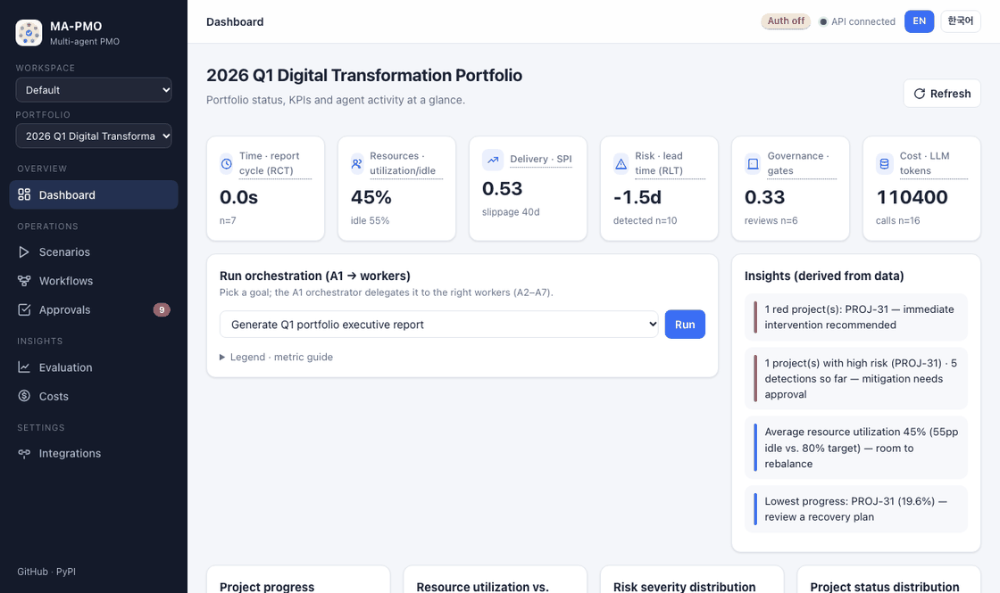
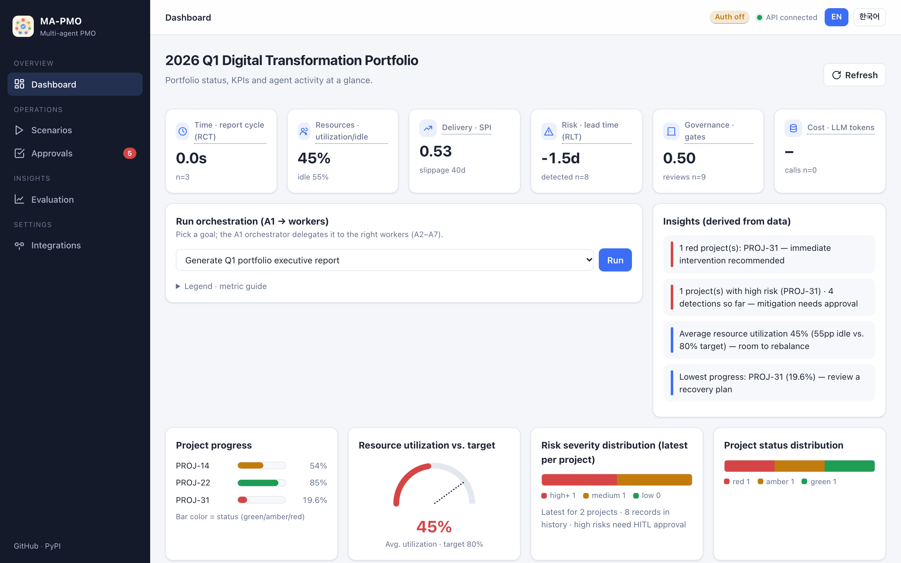
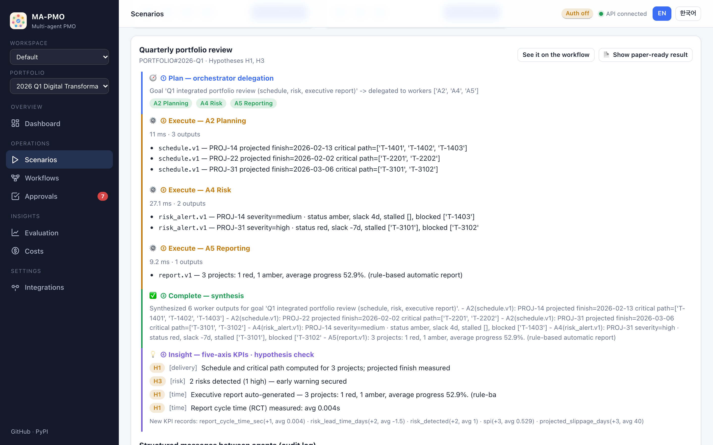
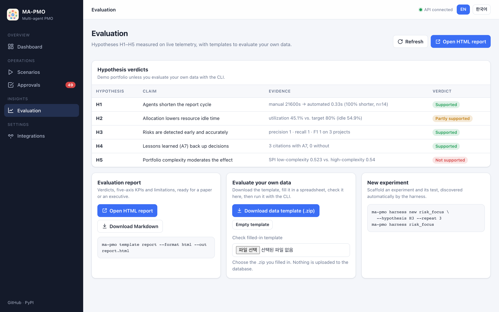
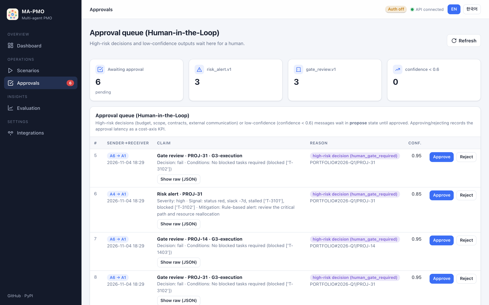
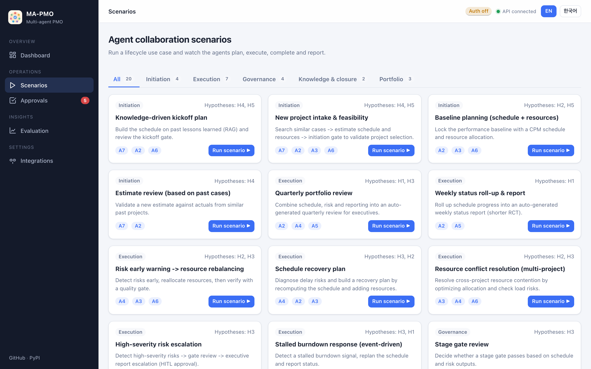
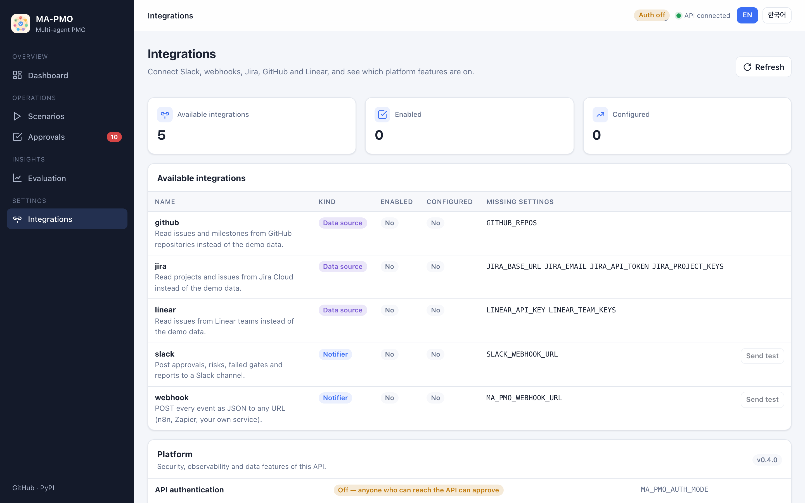

<p align="center">
  
</p>

<h1 align="center">MA-PMO — Multi-Agent Project Management Office</h1>

<p align="center"><i>Seven little AI agents that run your PMO — and always ask a human before the big decisions.</i></p>

<p align="center"><b>English</b> | <a href="https://github.com/ma-pmo/ma-pmo-ext/blob/main/README.ko.md">한국어</a></p>

[](https://github.com/ma-pmo/ma-pmo-ext/actions/workflows/ci.yml)
[](https://pypi.org/project/ma-pmo/)
[](https://www.python.org/)
[](https://github.com/ma-pmo/ma-pmo-ext/blob/main/LICENSE)
[](https://github.com/ma-pmo/ma-pmo-ext/blob/main/COMMERCIAL_LICENSE.md)

An LLM-backed **supervisor–worker multi-agent system** for portfolio and project management. Seven agents (A1–A7) plan schedules, allocate resources, detect risks early, review stage gates, search lessons learned and write executive reports. They talk to each other through versioned, schema-validated messages, and a human approves every high-risk decision.

MA-PMO turns the proof-of-concept simulation of the *MA-PMO* paper into a real, measurable system: every action is instrumented on five efficiency axes so hypotheses **H1–H5** can be tested on real telemetry.

> 🇰🇷 **한국어 요약** — LLM 기반 감독자–작업자 멀티 에이전트(A1~A7)로 PMO 업무(일정·자원·리스크·게이트·지식·보고)를 자동화하는 오픈소스입니다. 대시보드와 생성 결과는 **영어/한국어를 모두 지원**합니다(화면 우측 상단 `EN | 한국어`). 오픈소스(AGPL-3.0)로 무료 사용 가능하며, **상업적 사용(소스 비공개 SaaS·자사 제품 탑재 등)과 각종 문의는 [mjinttt@gmail.com](mailto:mjinttt@gmail.com)** 으로 연락주세요. 전체 한국어 문서: [README.ko.md](https://github.com/ma-pmo/ma-pmo-ext/blob/main/README.ko.md)



## Highlights

- **Seven cooperating agents** — A1 orchestrator routes goals to A2 Planning (CPM), A3 Resources, A4 Risk, A5 Reporting, A6 Governance and A7 Knowledge (RAG with mandatory citations).
- **Runs offline** — with no API key, every agent falls back to deterministic logic, so the whole pipeline works end to end. Add an Anthropic key or a local **Ollama** model to switch on the LLM path.
- **Structured, auditable communication** — Pydantic `.v1` message schemas instead of free-form chat, stored in an append-only log.
- **Human-in-the-loop** — high-severity risks, failed gates and low-confidence messages wait in an approval queue.
- **Measurable** — five-axis KPIs (time, resource, delivery, risk, cost), 20 lifecycle scenarios and an experiment harness that exports paper-ready Markdown.
- **Bilingual** — dashboard, API responses, reports and LLM output in English or Korean (`?lang=ko`, `Accept-Language`, or `MA_PMO_LANG`).
- **Pluggable integrations** — Slack and webhook notifications; Jira Cloud, GitHub or Linear as the data source; .ics resource calendars; and a plugin entry point for your own.
- **Evaluate on your own data** — fill-in data templates with line-by-line validation, H1–H5 reports with verdicts (Markdown/HTML), and an experiment scaffold (`ma-pmo harness new`).
- **MCP server** — `ma-pmo mcp` gives AI assistants eight tools over the Model Context Protocol; approvals stay human.
- **Learn harness engineering** — a [hands-on course](https://github.com/ma-pmo/ma-pmo-ext/blob/main/docs/learn/README.md): eight lectures and six labs with automatic checks (`ma-pmo learn`).
- **Admin dashboard** — sidebar navigation with a pending-approvals badge, Evaluation and Integrations pages, light/dark themes and a mobile layout.

## Screenshots

| Dashboard | Agent collaboration trace |
|---|---|
|  |  |
| **Evaluation (verdicts, calibration, search quality)** | **Human-in-the-loop approvals** |
|  |  |
| **20 lifecycle scenarios** | **Integrations and platform status** |
|  |  |

Korean UI: [dashboard](https://raw.githubusercontent.com/ma-pmo/ma-pmo-ext/main/docs/assets/dashboard-ko.png) · [scenario trace](https://raw.githubusercontent.com/ma-pmo/ma-pmo-ext/main/docs/assets/scenario-trace-ko.png) · [evaluation](https://raw.githubusercontent.com/ma-pmo/ma-pmo-ext/main/docs/assets/evaluation-ko.png) · [approvals](https://raw.githubusercontent.com/ma-pmo/ma-pmo-ext/main/docs/assets/approvals-ko.png) · [scenarios](https://raw.githubusercontent.com/ma-pmo/ma-pmo-ext/main/docs/assets/scenarios-ko.png) · [integrations](https://raw.githubusercontent.com/ma-pmo/ma-pmo-ext/main/docs/assets/integrations-ko.png). Light and dark themes follow the OS setting.

## Quick start

### Install from PyPI (API + agents + CLI)

```bash
pip install ma-pmo
ma-pmo init-db                 # create the SQLite schema and load the demo portfolio
ma-pmo serve                   # API on http://127.0.0.1:8000 (Swagger UI at /docs)
ma-pmo eval                    # H1–H5 evaluation summary (no API key needed)
```

### Run from source (includes the Next.js dashboard)

```bash
git clone https://github.com/ma-pmo/ma-pmo-ext.git && cd ma-pmo-ext
make dev          # install dependencies + create .env
make db-init      # SQLite schema + fixtures
make test         # test suite
make api          # FastAPI on http://localhost:8000/docs
make web          # dashboard on http://localhost:3000
```

**LLM options** (all optional — without them the deterministic fallbacks run):

| Mode | Setup |
|---|---|
| Offline | nothing to configure |
| Local Ollama (free) | `ollama pull llama3.1:8b` then `make api-ollama` |
| Anthropic Claude | set `ANTHROPIC_API_KEY` in `.env`, then `make api` |

Docker Compose and Kubernetes manifests are described in [deploy/README.md](https://github.com/ma-pmo/ma-pmo-ext/blob/main/deploy/README.md).

### Integrations (Slack, webhooks, Jira, GitHub, Linear)

Turn them on with environment variables; failures never stop the agents.

```bash
MA_PMO_INTEGRATIONS=slack,jira       # trackers: jira | github | linear (one at a time)
SLACK_WEBHOOK_URL=https://hooks.slack.com/services/...
JIRA_BASE_URL=https://your-team.atlassian.net  JIRA_EMAIL=...  JIRA_API_TOKEN=...  JIRA_PROJECT_KEYS=PAY,DATA
MA_PMO_CALENDAR_DIR=./calendars     # <resource_id>.ics per person: A3 allocates around meetings and leave
MA_PMO_RETRIEVER=vector             # A7 vector search (offline, or MA_PMO_EMBEDDING_MODEL=...)
```

`GET /integrations` shows what is active; `POST /integrations/slack/test` sends a test message. Setup, event list and how to write your own plugin: [docs/INTEGRATIONS.md](https://github.com/ma-pmo/ma-pmo-ext/blob/main/docs/INTEGRATIONS.md).

### Add your own agent (plugins)

A worker agent can live in its own package: declare an `AgentSpec`, register it under the `ma_pmo.agents` entry point, and the orchestrator routes to it, with the same audit log and approval gate as built-in agents. `ma-pmo agents` lists what is installed. Guide: [docs/PLUGINS.md](https://github.com/ma-pmo/ma-pmo-ext/blob/main/docs/PLUGINS.md), example: [examples/agent-plugin](https://github.com/ma-pmo/ma-pmo-ext/tree/main/examples/agent-plugin).

### MCP server (AI assistants)

```bash
pip install "ma-pmo[mcp]"
claude mcp add ma-pmo -- ma-pmo mcp      # or any MCP client: command `ma-pmo mcp`
```

Eight tools — portfolio status, CPM schedule, risks, pending approvals, scenarios, H1–H5 verdicts, lessons learned. Approving stays a human action. Setup: [docs/MCP.md](https://github.com/ma-pmo/ma-pmo-ext/blob/main/docs/MCP.md).

### Tracing agent runs (OpenTelemetry)

`pip install "ma-pmo[otel]"`, then `OTEL_ENABLED=true` (plus `OTEL_EXPORTER_OTLP_ENDPOINT` for Jaeger, Tempo or a collector). Each scenario run becomes one trace — workflow → agents → LLM calls — with fallbacks marked. Local Jaeger setup: [infra/otel](https://github.com/ma-pmo/ma-pmo-ext/blob/main/infra/otel/README.md).

### Authentication

The API starts with authentication **off** for local use. Before others can reach it, turn on API keys with roles (`viewer`, `operator`, `approver`, `admin`) — the approver recorded on a decision is then the authenticated user:

```bash
MA_PMO_AUTH_MODE=api_key
MA_PMO_API_KEYS=alice:approver:$(openssl rand -hex 24),ci-bot:operator:$(openssl rand -hex 24)
```

SSO/OIDC or a proxy header plug in as a custom authenticator: [docs/AUTH.md](https://github.com/ma-pmo/ma-pmo-ext/blob/main/docs/AUTH.md).

### Language

| Where | How |
|---|---|
| Dashboard | `EN \| 한국어` toggle (remembered), or `?lang=ko` in the URL |
| API | `?lang=ko` query parameter or `Accept-Language: ko` header |
| Default for CLI, reports and LLM output | `MA_PMO_LANG=en` (default) or `ko` |

### End-to-end demo

```bash
curl -X POST localhost:8000/orchestrate \
  -H 'content-type: application/json' \
  -d '{"goal": "Generate Q1 portfolio executive report"}'
# → A1 routes to A5 → status roll-up → report (LLM or fallback) → report.v1 validation → RCT KPI

curl 'localhost:8000/kpi?axis=time'      # report cycle time (RCT)
curl localhost:8000/approvals             # HITL pending queue

# A4 Risk: event-driven early detection
curl -X POST localhost:8000/webhooks/issue \
  -H 'content-type: application/json' \
  -d '{"project_id": "PROJ-31", "event_type": "issue_updated"}'
curl 'localhost:8000/risks?lang=ko'       # risk register, in Korean

# A2 Planning · A3 Resources · A6 Governance · A7 Knowledge (deterministic)
curl -X POST localhost:8000/plan
curl -X POST localhost:8000/allocate
curl -X POST 'localhost:8000/gate-review?gate=G2-planning'
curl -G localhost:8000/knowledge/search --data-urlencode 'q=data migration delay risk'

# Scenarios (plan → execute → complete → insight) with paper-ready Markdown
curl -X POST 'localhost:8000/scenarios/quarterly_review/run?format=markdown'
curl localhost:8000/eval                  # H1–H5 as JSON
```

### Evaluate on your own data (templates)

```bash
ma-pmo template data ./my-org            # fill-in CSV/JSON files + guide (English/Korean)
ma-pmo template validate ./my-org        # line-by-line checks: dates, numbers, ids, cycles
ma-pmo eval --data ./my-org              # H1–H5 on your data, in an isolated DB inside the folder
ma-pmo template report --data ./my-org --format html --out report.html   # report with verdicts
ma-pmo harness new risk_focus --hypothesis H3 --repeat 3                  # scaffold an experiment
```

The same is available over HTTP: `GET /templates/data.zip`, `POST /templates/validate` (zip body), `GET /eval/report?format=md|html`.

### Learn harness engineering (course)

Eight lectures on building dependable multi-agent systems, taught on this codebase, plus six labs (notifier, dataset repair, ablation, tracker, MCP tool, gate calibration) with starter files, reference solutions and automatic checks. Offline, no API key.

```bash
ma-pmo learn list          # the six labs
ma-pmo learn start 1       # copy the starter files to ./learn/lab1
ma-pmo learn check 1       # ✓/✗ per requirement, with hints
```

Start here: [docs/learn/README.md](https://github.com/ma-pmo/ma-pmo-ext/blob/main/docs/learn/README.md).

## Architecture

```
Presentation   Next.js dashboard · scenarios · HITL approval UI (English / Korean)
Orchestration  A1 Orchestrator (LangGraph supervisor)
Workers        A2 Planning · A3 Resources · A4 Risk · A5 Reporting · A6 Governance · A7 Knowledge
Shared state   Blackboard (PortfolioState) · append-only message log
Persistence    SQLite by default, Postgres with ma-pmo[postgres] · migrations · run records · LangGraph checkpoints
Platform       LLM gateway (LiteLLM: Anthropic / Ollama) · local RAG · structured logging
```

| Agent | Role | Needs an LLM? |
|---|---|---|
| A1 Orchestrator | decompose the goal → route to workers → synthesize | optional (keyword routing fallback) |
| A2 Planning | CPM critical path, projected finish, SPI/slippage | no |
| A3 Resources | skill-matching allocation, utilization/idle rate, overload alerts | no |
| A4 Risk | rule-based signals → severity and mitigation → HITL gate | optional (rule-based fallback) |
| A5 Reporting | executive status report (`report.v1`) + RCT | optional (rule-based fallback) |
| A6 Governance | stage gates G1–G4 against a checklist | no |
| A7 Knowledge | lessons-learned retrieval with enforced citations | retrieval no, synthesis optional |

## Hypothesis validation (H1–H5)

| Hypothesis | Measurement | Baseline / ground truth |
|---|---|---|
| H1 Reporting time | RCT before/after (A5) | manual baseline in `ma_pmo/fixtures/baselines.json` |
| H2 Idle rate | resource utilization / idle rate (A3) | target utilization |
| H3 Risk | rule-based detection precision / recall / F1 | labels in `ma_pmo/fixtures/risk_ground_truth.json` |
| H4 Success rate | A7 knowledge ablation (citation coverage) | A7 on / off |
| H5 Moderation | SPI stratified by portfolio complexity | complexity median |
| Calibration | ECE / Brier of agent confidence; HITL threshold what-if | risk labels, approval decisions |

See [docs/PAPER_VALIDATION_GUIDE.md](https://github.com/ma-pmo/ma-pmo-ext/blob/main/docs/PAPER_VALIDATION_GUIDE.md) for the full reproduction procedure, and [ma_pmo/harness/README.md](https://github.com/ma-pmo/ma-pmo-ext/blob/main/ma_pmo/harness/README.md) for batch experiments and ablations.

### Five-axis KPIs

| Axis | Metric | Instrumentation |
|---|---|---|
| Time | report cycle time (RCT) | request → completion timestamps |
| Resource | utilization / idle rate | allocated vs. available capacity |
| Delivery | SPI, slippage, gate score | CPM + EVM events |
| Risk | lead time (RLT), detections | detected_at vs. expected materialization |
| Cost | tokens, latency, approval delay | LLM gateway usage + HITL |

> Includes the **agent operating cost** (tokens, latency, hand-offs, approval delay) that the original simulation left out.

### Paper ↔ implementation

| Paper | Implementation |
|---|---|
| §3.2 Agent table | `ma_pmo/agents/` |
| §3.3 Message protocol | `ma_pmo/core/schemas/`, `ma_pmo/core/protocol.py` |
| §3.5 Five-axis metrics | `ma_pmo/core/kpi.py`, `kpi_event` table |
| §4 Simulation → real measurement | `ma_pmo/agents/`, `ma_pmo/core/`, `ma_pmo/eval/` |
| Hypotheses H1–H5 | `ma_pmo/eval/`, `ma_pmo/harness/` |
| §8 Governance (HITL) | `ma_pmo/core/hitl.py`, `ma_pmo/core/graph.py` |

## Project layout

```
ma_pmo/            Python package (published to PyPI)
  agents/          A1–A7 and the agent registry
  sdk/             public SDK for agent plugins
  api/             FastAPI app and routers
  core/            schemas, protocol, KPIs, HITL, graph, i18n, scenarios
  connectors/      issue tracker (mock), resource calendars (.ics), knowledge store
  integrations/    Slack, webhook, Jira, GitHub and Linear integrations + plugin registry
  db/              SQLAlchemy models and init
  eval/  harness/  hypothesis evaluation and experiment harness
  learn/           course labs: starters, solutions, automatic checks
  fixtures/        demo portfolio, lessons learned (English + Korean), baselines
apps/web/          Next.js dashboard (English / Korean)
deploy/  infra/    Docker, Kubernetes, optional production infra
docs/              paper validation guide, course (docs/learn), evidence, screenshots
tests/             pytest suite
```

## Contributing

Contributions are welcome! Please read [CONTRIBUTING.md](https://github.com/ma-pmo/ma-pmo-ext/blob/main/CONTRIBUTING.md) for setup, tests and the PR process, and follow the [Code of Conduct](https://github.com/ma-pmo/ma-pmo-ext/blob/main/CODE_OF_CONDUCT.md). Report vulnerabilities privately as described in [SECURITY.md](https://github.com/ma-pmo/ma-pmo-ext/blob/main/SECURITY.md). Release notes are in [CHANGELOG.md](https://github.com/ma-pmo/ma-pmo-ext/blob/main/CHANGELOG.md).

## License

MA-PMO is **dual-licensed**:

| Use case | License | Cost |
|---|---|---|
| Personal, academic, research, evaluation and open-source projects | [GNU AGPL-3.0-or-later](https://github.com/ma-pmo/ma-pmo-ext/blob/main/LICENSE) | Free |
| Commercial / proprietary use where you **cannot or do not want to** meet the AGPL obligations (e.g. closed-source SaaS, embedding in a proprietary product, a hosted service without source disclosure) | [Commercial license](https://github.com/ma-pmo/ma-pmo-ext/blob/main/COMMERCIAL_LICENSE.md) | Contact us |

Under the AGPL you may use, modify and redistribute MA-PMO freely — **including commercially** — as long as you release the complete corresponding source of your modified version under the AGPL, *including* when users interact with it over a network (AGPL §13). If that does not work for your business, a commercial license removes those obligations and can include support, warranty and custom terms.

Copyright © 2026 myeongjin.ji. See [NOTICE](https://github.com/ma-pmo/ma-pmo-ext/blob/main/NOTICE).

> This section is a plain-language summary, not legal advice. The [LICENSE](https://github.com/ma-pmo/ma-pmo-ext/blob/main/LICENSE) text governs.

## Trademark

"MA-PMO" and the MA-PMO logo are trademarks of myeongjin.ji. The open-source license covers the code, not the name. You can say a product is "built with MA-PMO" or "a fork of MA-PMO", but using the name for a commercial product or service needs permission. See [TRADEMARKS.md](https://github.com/ma-pmo/ma-pmo-ext/blob/main/TRADEMARKS.md).

## Commercial use & contact

📧 **[mjinttt@gmail.com](mailto:mjinttt@gmail.com)**

- **Commercial licensing** — closed-source / SaaS / OEM use, pricing and terms
- **Enterprise support** — deployment, integration (Jira, calendar, vector DB connectors), customization
- **Research collaboration** — paper validation (H1–H5), joint experiments, citation questions
- **General questions** — anything not suited to a public issue

For bugs and feature requests, please use [GitHub Issues](https://github.com/ma-pmo/ma-pmo-ext/issues) so others can benefit. For security vulnerabilities, follow [SECURITY.md](https://github.com/ma-pmo/ma-pmo-ext/blob/main/SECURITY.md) and **do not** open a public issue.

## Citation

If you use MA-PMO in research, please cite it using [CITATION.cff](https://github.com/ma-pmo/ma-pmo-ext/blob/main/CITATION.cff) (GitHub's "Cite this repository" button).
